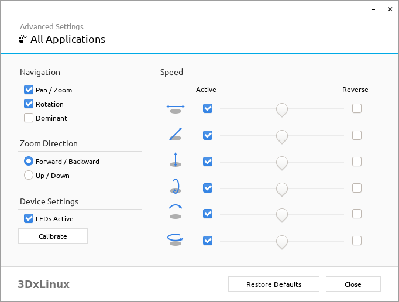
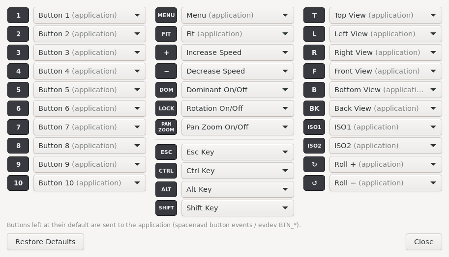
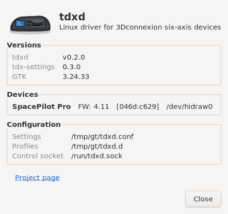

# 3DxLinux — 3Dconnexion driver for Linux (x86_64, arm64, …)

3DxLinux is a user-space Linux driver for 3Dconnexion devices. It focuses on the
**SpacePilot Pro** (046d:c629), including its 320×240 colour LCD. Its driver
program is `tdxd`; the commands, services and settings files keep that name
(`tdxctl`, `tdxd.service`, `/etc/tdxd.conf`).

It was rebuilt by reverse engineering the Windows package
`3DxWare64_v10-9-14_b745.exe` (see [docs/PROTOCOL.md](docs/PROTOCOL.md)).

The Windows driver can't simply be recompiled: it is a KMDF kernel filter plus
Win32 services. Instead, 3DxLinux re-implements the device protocol those
components speak, using standard Linux interfaces:

| Windows component (3DxWare) | Linux replacement in 3DxLinux |
|---|---|
| `3dxhid.sys` HID filter: report parsing, axis remap | `hidraw` reader + `report.c` / `process.c` |
| `3DxService.exe` + `Base.xml` device database | `devices_gen.c` (generated from `Base.xml`) + `/etc/tdxd.conf` |
| Input injection to apps | `uinput` virtual device and a spacenavd-compatible socket (`libspnav` apps) |
| Logitech `LCDMon` / `EDMBTDD.dll` / `LGPBTDD.sys` | `lcd.c` over usbfs: bulk frames and vendor brightness request |
| `HIDDev.dll` LED on/off | HID output report `{0x04, on}` |
| `HIDDev.dll` RGB LED colours (Giotto) | HID feature report `{0x1A, 0x25, led, R, G, B, 0, 0}` |
| `HIDDev.dll` LCD intensity (Enterprise) | HID feature report `{0x11, percent}` |
| `HIDDev.dll` `CWinUSBLCDMgr` (Giotto 1280×416 LCD) | `lcd_giotto.c`: rotated 24 bpp raw-deflate frames, double-buffered with 64-byte command packets (0x20/0x24/0x22); 0x21 rectangle writes; the legacy sp4LCD.bmp 0x13 path (optional directory watcher); slide animation between up to 4 pages and the vertical "move" operation, both with 0x23 rectangle copies |
| `HIDDev.dll` `CWinUSBLCDMgr` (Enterprise 640×150 LCD) | `lcd_ent.c` + `deflate.c`: 512-byte header packet and raw-deflate RGB565 frames over usbfs |
| `3DxLCDSPPRO.exe` "Function Keys" applet | built-in key-label pages: SpacePilot Pro keys 1–5 (SHIFT shows 6–10), Enterprise and Giotto keys 1–12; or any PPM image |

## Supported devices

There are 29 devices from the 3DxWare database plus 7 legacy PIDs (`tdxd -l`).
Device support is data-driven. Button layouts come from `Base.xml`, so other
3Dconnexion 3D mice work the same way. CadMouse and keyboards are skipped
because they already work through `hid-generic`.

The **Universal Receiver** (256f:c652) is recognised: `tdxd` reads which
devices are paired to it and the battery level of a paired CadMouse, and
3Dconnexion Settings shows the receiver and the CadMouse pages with 3DxWare's
device chooser. The CadMouse itself keeps working as an ordinary mouse.
Its Speed (DPI), Polling Rate and Smart Scrolling are sent to the mouse, as
3DxWare does (`mouse_dpi`, `mouse_polling_rate`, `mouse_smart_scrolling` in
`/etc/tdxd.conf`). Pointer acceleration and the wheel's lines per notch are your
desktop's mouse settings. Its Buttons (radial-menu, wheel, middle, forward and
back) can be a mouse function, done by the mouse itself, or a keystroke, which
`tdxd` sends; per application too (`key_V2DK_FORWARD = KEY_LEFTCTRL+KEY_Z`,
`key_V2DK_WHEEL = BTN_MIDDLE`, `mouse_swap_buttons = yes`). 3DxWare's radial
menu (Common Tools) is not on Linux: that button does nothing until you give it
something.

## Build

The only build dependency is a C11 compiler with Linux UAPI headers. There are
no library dependencies.

```bash
make                 # native (x86_64 or arm64 host)
```

```bash
make ARCH=arm64      # cross-compile with aarch64-linux-gnu-gcc
```

```bash
make CROSS_COMPILE=riscv64-linux-gnu-   # any other GCC cross toolchain
```

```bash
make STATIC=1        # static binaries for appliances or Raspberry Pi images
```

```bash
make test            # host unit tests (report parsing, LCD framing, config)
```

The outputs are `build/<arch>/tdxd` (the daemon) and `build/<arch>/tdx-lcd`
(a standalone LCD tool).

## Install

### Packages (double-click)

Each release has `.deb` packages (Ubuntu, Debian, Mint, Pop!_OS) and `.rpm`
packages (Fedora, openSUSE) for x86_64 and arm64. Double-click the one for your
system, click **Install** and enter your password. That's all: the package
pulls in Python 3 and GTK 3, loads `uinput`, sets up the udev rule, starts
`tdxd`, and starts the LCD Manager in your session. It replaces `spacenavd` if
that is installed. Uninstall it from the same software app: that removes
everything 3DxLinux added, including your settings (`/etc/tdxd.conf`, the profiles
in `/etc/tdxd.d`, each user's `~/.config/tdxd`) and the imported 3DxWare look.
Upgrading keeps your settings.

| File | For |
|---|---|
| `3DxLinux.<version>-1.amd64.deb` / `3DxLinux.<version>-1.arm64.deb` | Debian-based systems |
| `3DxLinux.<version>-1.x86_64.rpm` / `3DxLinux.<version>-1.aarch64.rpm` | Fedora, openSUSE |

Software centres list it as **3DxLinux** by Bassquake (the package itself is
called `tdxd`, as are its commands and services). Discover's page for a
downloaded package file shows only the file's name and the package's
description, so there it says "Unknown author".

The packages install under `/usr`. If you used `install.sh` before, remove that
copy first with `sudo ./install.sh --remove` from its folder. `make packages`
builds the packages for one architecture (needs `dpkg-deb` and `rpmbuild`).

### From source

```bash
sudo make install
```

```bash
sudo udevadm control --reload && sudo udevadm trigger
```

```bash
sudo systemctl enable --now tdxd
```

`tdxd` provides the spacenavd socket (`/run/spnav.sock`), so don't run
`spacenavd` at the same time (the service unit declares `Conflicts=`).
Edit `/etc/tdxd.conf` and apply the changes with `systemctl reload tdxd`.

### Prebuilt package (no compiler on the test machine)

`make dist` builds static, stripped binaries and packs them with the udev rule,
the service, the config and an install script. Use `make dist ARCH=arm64` for
arm64.

```bash
tar xzf tdxd-*-linux-x86_64.tar.gz && cd tdxd-*-linux-x86_64
```

```bash
sudo ./install.sh
```

```bash
sudo tdxd -v -v
```

Running the daemon in the foreground shows each detected device, every button
press (with `-v -v`), and any LCD / LED errors. `sudo ./install.sh --remove`
uninstalls everything except `/etc/tdxd.conf`.

### First hardware test checklist

1. `tdxd -l` lists the device's VID:PID, and `ls /dev/hidraw*` shows its node.
2. `sudo tdxd -v -v`, then move the cap and press buttons: events are logged.
   `evtest` shows the "3Dconnexion … (tdxd)" device.
3. LCD: stop the daemon, then run `sudo tdx-lcd fill bars`. On a SpacePilot Pro,
   also run `sudo tdx-lcd ping` and `sudo tdx-lcd brightness 50`.
4. If colours look wrong (red/blue swapped) or the image is upside down, note
   it. These are the inferred parts listed in `docs/PROTOCOL.md`.

The SpacePilot Pro LCD has only three brightness levels; requests snap to
30 %, 60 % or 90 %.

### Testing from Windows with WSL2

A Windows PC can run the Linux build against a real device by passing it into
WSL2 with [usbipd-win](https://github.com/dorssel/usbipd-win). That is how
[docs/HARDWARE_TESTS.md](docs/HARDWARE_TESTS.md) was done. While the device is
attached, Windows and 3DxWare cannot use it.

1. **Share the device.** In an admin PowerShell, run `usbipd list` and note the
   device's bus ID. Then run `usbipd bind --busid <id> --force`.
   - `--force` is needed while the 3Dconnexion / Logitech drivers own the device.
   - **Unplug and replug the device** so the forced bind takes effect.
2. **Load the modules.** In WSL, as root, keep a shell open so the VM stays
   running, then load the modules:

   ```bash
   modprobe vhci_hcd usbhid hid_generic uinput evdev
   ```

3. **Attach.** In PowerShell:

   ```bash
   usbipd attach --wsl --busid <id>
   ```

4. **Test in WSL.** Run `tdxd -v -v` and `tdx-lcd fill bars` as above.
5. **Give it back.** Run `usbipd detach --busid <id>`, then
   `usbipd unbind --busid <id>` as admin. Windows reloads its drivers.

## Settings panel (`tdx-settings`)

`tdx-settings` (**3Dconnexion Settings** in the menu, under System or Settings)
is a GTK 3 port of the 3DxWare control panel with the same
windows, layout and controls: the main window (device, Speed), **Advanced
Settings**, **Buttons**, **LCD Manager** and **About** ("More ›"). It edits the
same files as the table below and keeps their comments. As in 3DxWare, every
change takes effect right away: the panel saves it and runs `tdxctl reload`.
Files in `/etc` that you cannot write are saved through `pkexec
tdx-settings-helper`: the system asks for your password at the first change and
then remembers it for a few minutes. If you cancel the password prompt, the
panel stops asking and saves when you close the window instead.
The window title names the profile being edited; click it to switch between the
defaults and the per-application profiles, or to create one for the focused
application. With no device plugged in, the window shows 3DxWare's "No device
found" page instead, until one is connected.

**More ›** opens 3DxWare's menu:

- **Import settings / Export settings:** a `.zip` with `/etc/tdxd.conf` and your
  profiles in `/etc/tdxd.d`. Importing replaces the base settings and the
  profiles of the same names; other profiles stay.
- **Reset all settings:** the base settings back to their defaults, the FreeCAD
  profile back to its shipped one, your other profiles removed. The profiles
  imported from 3DxWare stay.
- **Support** opens this project's issues page, and **About** the About window.

### The icon in the system tray (`tdx-tray`)

As 3DxWare does on Windows, a 3Dconnexion icon sits in the system tray, next to
the network, volume and other icons. Left-click it to open the settings panel.
Right-click it for a menu:

- **Open 3Dconnexion Settings** opens the panel, or brings it to the front if
  it's already open.
- **Write Log File** writes `tdxd-log-<date>-<time>.txt` to your Desktop: the
  versions, what `tdxd` sees, your settings files, and the recent messages of `tdxd`
  and the LCD Manager. A notification says where it is; click it to open the
  folder. The file includes your computer's name and your user name.
- **Start with the Desktop** (a tick box): untick it and the tray icon and the
  LCD Manager no longer start when you log in. The same tick box is in the
  settings panel's About window, where ticking it also starts them again.
- **Quit** closes the tray icon and the LCD Manager until you next log in, or
  until you open the settings panel, which brings them back (unless Start with the
  Desktop is off).

`tdxd` itself, the driver, keeps running either way, so the 3D mouse keeps
working and the LCD shows `tdxd`'s own key page. To stop the driver too, run
`sudo systemctl stop tdxd` (and `sudo systemctl disable tdxd` to keep it from
starting at boot).

The packages start the tray icon with every desktop session. It uses the
StatusNotifierItem tray of KDE Plasma, Xfce, Cinnamon and others; GNOME shows it
with the AppIndicator extension. `tdx-tray --write-log` writes the log file from
a terminal. The tick box works per user: it masks your own copies of
`tdx-tray.service` and `tdx-lcdmgr.service` (`systemctl --user unmask …` undoes
it), so it needs no password.

### The 3DxWare look

The 3DxWare artwork (backgrounds, device photos, key caps, axis icons, check
boxes, slider thumbs, function icons) belongs to 3Dconnexion and is **not**
included with 3DxLinux. If you have the Windows installer (download it from
3Dconnexion), copy the artwork out of it once. The easiest way: in `tdx-settings`
click **More ›**, then **About**, then **Import 3DxWare look…**, and pick the
installer. It imports for your user (no password), then restarts the panel and
the LCD Manager so both show it. From a terminal:

```bash
sudo tdx-extract-3dxware-ui 3DxWare64_v10-9-14_b745.exe     # -> /usr/local/share/tdxd/3dxware-ui
tools/extract_3dxware_ui.py 3DxWare64_v10-9-14_b745.exe     # or per user -> ~/.local/share/tdxd/3dxware-ui
```

The extractor only reads files (7z unpacks installer → MSI → CAB; the MSI
`File` table gives the names; the images are parsed out of the .NET resources of
`3DxSmartUi.exe`; `Base.xml` gives each device's photo and support status; the
application XML files become key profiles, see below). It
needs `7z` (`p7zip-full`). Without the artwork the same layout is drawn with
plain shapes, as in these screenshots:

| Main window | Advanced Settings |
|---|---|
|  |  |

| Buttons |
|---|
|  |

| LCD Manager | About |
|---|---|
|  |  |

It needs Python 3 with PyGObject: `sudo apt install python3-gi python3-gi-cairo
gir1.2-gtk-3.0` (Fedora: `python3-gobject gtk3`). The Buttons window currently
shows the SpacePilot Pro layout. `tdx-settings --snapshot DIR` renders every
window to PNG (`--no-assets` forces the built-in drawings).

## Settings (compared with 3DxWare on Windows)

Everything is set in `/etc/tdxd.conf` (or with `tdx-settings`); apply changes
with `tdxctl reload` or `systemctl reload tdxd`.

| 3DxWare setting | 3DxLinux |
|---|---|
| Speed | `sensitivity` |
| Pan/Zoom, Rotation, Dominant | `disable_translation`, `disable_rotation`, `dominant` |
| Per-axis Active / speed / Reverse | `scale_tx … scale_rz` (0 = off) / `invert_tx … invert_rz` |
| Zoom direction | `map_ty = tz` + `map_tz = ty` |
| LEDs Active | `led` |
| **Calibrate** | `tdxctl calibrate`, `calibrate_button`, or `calibrate_on_start` |
| Buttons: keystrokes | `key_<V3DK id> = KEY [+ KEY …]` (or `none`) |
| Buttons: Increase/Decrease Speed, Dominant/Rotation/Pan Zoom On/Off, Calibrate | `action_<V3DK id> = speed_up \| speed_down \| dominant \| rotation \| panzoom \| calibrate` (handled by `tdxd`, not sent to the application; the shipped config binds +, −, DOM, LOCK and PAN ZOOM like 3DxWare) |
| LCD Manager (Logitech LCDMon: applets, switching, brightness) | `tdx-lcdmgr` + `tdx-lcdmanager`, see [docs/LCD_MANAGER.md](docs/LCD_MANAGER.md); without it `tdxd`'s key page: `lcd_brightness`, `lcd_label_N`, `lcd_image` |
| **Per-application settings** | `/etc/tdxd.d/<name>.conf` profiles |

### Calibrate

Leave the cap untouched, then run:

```bash
tdxctl calibrate
```

This sends the same firmware re-zero command as the Calibrate button in
3DxWare: HID feature report `0x07`, from `UdDevRezero` in `HIDDev.dll`. As in
3DxWare, devices with firmware older than 2.00 are skipped. You can also bind it
to a button with `calibrate_button = V3DK_…`, or run it whenever a device
connects with `calibrate_on_start = yes`.

### Per-application profiles

A profile is a file in `/etc/tdxd.d/` ending in `.conf`. It holds any
`tdxd.conf` options and is layered on top of the base file while a matching
application has the focus. Daemon-wide options (sockets, uinput, spnav, `lcd`)
can't be set in a profile. Start from the shipped example:

```bash
sudo cp /etc/tdxd.d/blender.conf.example /etc/tdxd.d/blender.conf && tdxctl reload
```

`match = blender, blender-*` lists the process names (case-insensitive, globs
allowed). Without it, the file name is used.

`tdxd` learns which application is focused in one of two ways:

- **`tdx-focus` (X11 or sway).** Run it in your desktop session:

  ```bash
  systemctl --user enable --now tdx-focus
  ```

- **Fallback.** Without `tdx-focus`, `tdxd` uses the newest application connected
  to the spacenavd socket (Blender, FreeCAD, …). That covers the common case of
  one 3D application, including on Wayland desktops that `tdx-focus` doesn't
  support.

`tdxctl status` shows the active profile and how the application was detected.
`tdxctl profiles` lists the profiles.

### 3DxWare's key settings for each application

3DxWare ships its key settings for about 280 applications as XML files
(`Blender.xml`, `prusa-slicer.xml`, …), with the keystrokes and names in
`en-US.xml`. Importing the 3DxWare look (above) turns every one that 3DxLinux can do
into a profile named `3dx-<application>` in `…/3dxware-ui/profiles`. That is 66
profiles with 3DxWare 10.9.14, among them Blender, PrusaSlicer, OrcaSlicer,
Bambu Studio, Cura, Firefox and Chrome. On the keys, each profile has:

- keyboard shortcuts, including macros that type several keys in a row;
- 3DxWare's names for the LCD;
- driver functions (speed, rotation, pan/zoom, dominant, settings panel).

Some of 3DxWare's key functions don't exist on Linux, so those keys keep 3DxLinux's
defaults:

- the application's own NavLib commands (FreeCAD has its add-on, below);
- 3DxWare's SDK view commands;
- radial menus;
- mouse macros.

A program matches by its process name, taken from 3DxWare's `.exe` name.

Your own profiles in `/etc/tdxd.d` come first: a profile there that matches the
same program, or has the same name, wins. `tdxd` reads the profiles from
`/usr/local/share/tdxd/3dxware-ui/profiles` (imported as root) and from
`~/.local/share/tdxd/3dxware-ui/profiles` of the desktop user (the one running
`tdx-focus` or the settings panel). From a user's folder it takes only keys, key
names and actions.

### FreeCAD: keys that follow the workbench

On Windows, 3DxWare gives FreeCAD a different set of key functions for each
workbench (Part Design key 1 is "Create sketch", Sketcher has its own set, and
so on), with radial menus on some keys. 3DxLinux does the same with a small FreeCAD
add-on:

1. Import the 3DxWare look (above). Besides the artwork this reads the key sets
   out of 3DxWare's `FreeCAD_Navlib.xml` into `freecad/buttons.json`, and puts
   the add-on loader in `~/.local/share/FreeCAD/Mod/TdxdSpaceMouse` (also done
   by `tdx-focus` at login, or by hand with `tdx-freecad-addon install`).
2. Restart FreeCAD.

The add-on tells `tdxd` which keys the active workbench uses and what to call them
on the LCD (`tdxctl app-buttons`); `tdxd` then sends those keys only to FreeCAD,
which runs the command. A radial menu opens as a pop-up menu at the mouse
pointer. Keys a workbench leaves out keep their usual functions, and a command
you set yourself in FreeCAD's Spaceball button settings is left alone.
`tdx-freecad-addon remove` takes the add-on out again. Nothing from 3DxWare is
shipped with 3DxLinux: the key sets come from your own installer.

FreeCAD from Flathub works too: `tdx-freecad-addon install` also puts the loader
in `~/.var/app/org.freecad.FreeCAD/data/FreeCAD/…/Mod` and lets the sandbox
reach `tdxd`'s socket (`flatpak override --user --filesystem=/run/tdxd.sock
org.freecad.FreeCAD`; `remove` takes that back). FreeCAD as a Snap isn't
supported.

## LCD

### LCD Manager and applets

`tdx-lcdmgr` is a Linux port of Logitech's LCD Manager (LCDMon), which 3DxWare
uses to run applets (Function Keys, RSS Feeds, Picture Viewer) on the
SpacePilot PRO LCD. Run it as your user (`systemctl --user enable --now
tdx-lcdmgr`); it takes the LCD over from `tdxd`, serves applets written against
the lglcd-compatible `libtdxlcd` (C) or `tdxlcd.py`, and handles the LCD's own
navigation keys (LCD key, UP/DOWN/OK/CANCEL). The **LCD Manager** button in
`tdx-settings` opens its window, `tdx-lcdmanager`. Details, the recovered
protocol and the API: [docs/LCD_MANAGER.md](docs/LCD_MANAGER.md). Try it with
`tdx-lcd-demo -a`.

### The driver's built-in key page (`tdxd`)

`tdx-lcd` finds the panel automatically: SpacePilot Pro (320×240), SpaceMouse
Enterprise (640×150) or Giotto (1280×416). Use `-d VID:PID` to pick one.

```bash
tdx-lcd preview page.ppm /etc/tdxd.conf   # render the key page offline
```

```bash
tdx-lcd fill bars                          # test pattern (stop tdxd or set lcd = no first)
```

```bash
tdx-lcd image splash.ppm                   # 320x240 binary PPM
```

```bash
tdx-lcd brightness 60
```

```bash
tdx-lcd ping                               # exit 0 if the panel answers vendor request 0x01
```

```bash
tdx-lcd slide p1.ppm p2.ppm p3.ppm         # Giotto: slide animation across 1280x416 pages
```

```bash
tdx-lcd move sheet.ppm background.ppm     # Giotto: push an image down, uncovering the background
```

```bash
tdx-lcd rect 0 0 1280 60 page.ppm         # Giotto: rewrite only that rectangle
```

```bash
tdx-lcd bmp sp4LCD.bmp                    # Giotto: legacy 0x13 path (24 bpp BMP)
```

## Status

| Feature | Evidence |
|---|---|
| Report formats, button masks, both LCD frame formats, brightness, ping, LED and RGB LED requests | Recovered from the shipped binaries (Ghidra decompilation) |
| Parsers, frame packers and LCD headers | Unit-tested |
| Deflate encoder | Round-trip checked against Python zlib in `make test` |
| x86_64 and arm64 builds | Compile without warnings |
| SpacePilot Pro on real hardware | **Verified** (2026-11-16, see [docs/HARDWARE_TESTS.md](docs/HARDWARE_TESTS.md)): motion, buttons, the uinput and spacenavd outputs, LCD frames, ping, brightness (3 levels), LED, the daemon's key page with SHIFT paging, and **Blender 3.0.1** navigation and view buttons through libspnav |
| SpaceMouse Enterprise and Giotto | Not verified on hardware (no device available) |
| LCD Manager (`tdx-lcdmgr`, `libtdxlcd`, `tdx-lcdmanager`) and the applets (Function Keys, RSS Feeds, Picture Viewer) | **Verified** on the SpacePilot Pro (2026-11-17): handover to and from `tdxd`, all eight LCD keys, the program list in the Windows look, the three applets and their Configure dialogs, autostart, Identify, brightness; end to end in `make test-lcdmgr` and `make test-lcdapplets` |
| `tdx-settings` panel and `action_*` button actions | **Verified** on the SpacePilot Pro (2026-11-17): speed ±, Dominant/Rotation/Pan Zoom toggles, and the panel's Speed, LEDs, Calibrate, button binding, LCD brightness and labels. Also unit-tested (`make test-gui`) |

`docs/PROTOCOL.md` lists the open items.

## Regenerating the device table

Extract `Base.xml` from `3DxWinCore64.msi`, then run:

```bash
make devices BASE_XML=/path/to/Base.xml
```
