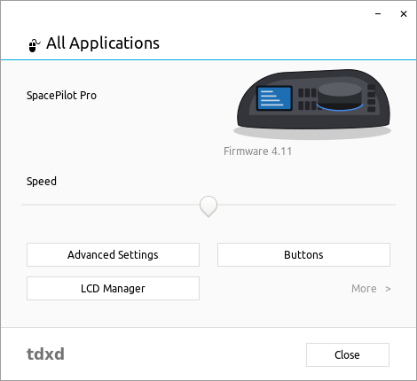
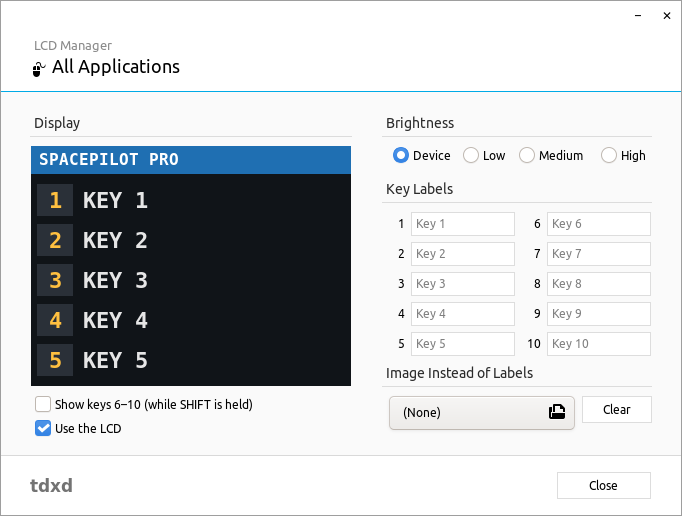

# tdxd — 3Dconnexion driver for Linux (x86_64, arm64, …)

`tdxd` is a user-space Linux driver for 3Dconnexion devices. It focuses on the
**SpacePilot Pro** (046d:c629), including its 320×240 colour LCD.

It was rebuilt by reverse engineering the Windows package
`3DxWare64_v10-9-14_b745.exe` (see [docs/PROTOCOL.md](docs/PROTOCOL.md)).

The Windows driver can't simply be recompiled: it is a KMDF kernel filter plus
Win32 services. Instead, `tdxd` re-implements the device protocol those
components speak, using standard Linux interfaces:

| Windows component (3DxWare) | Linux replacement in `tdxd` |
|---|---|
| `3dxhid.sys` HID filter: report parsing, axis remap | `hidraw` reader + `report.c` / `process.c` |
| `3DxService.exe` + `Base.xml` device database | `devices_gen.c` (generated from `Base.xml`) + `/etc/tdxd.conf` |
| Input injection to apps | `uinput` virtual device and a spacenavd-compatible socket (`libspnav` apps) |
| Logitech `LCDMon` / `EDMBTDD.dll` / `LGPBTDD.sys` | `lcd.c` over usbfs: bulk frames and vendor brightness request |
| `HIDDev.dll` LED on/off | HID output report `{0x04, on}` |
| `HIDDev.dll` RGB LED colours (Giotto) | HID feature report `{0x1A, 0x25, led, R, G, B, 0, 0}` |
| `HIDDev.dll` LCD intensity (Enterprise) | HID feature report `{0x11, percent}` |
| `HIDDev.dll` `CWinUSBLCDMgr` (Giotto 1280×416 LCD) | `lcd_giotto.c`: rotated 24 bpp raw-deflate frames, double-buffered with 64-byte command packets (0x20/0x24/0x22); 0x21 rectangle writes; the legacy sp4LCD.bmp 0x13 path (optional directory watcher); slide animation between up to 4 pages and the vertical "move" operation, both with 0x23 rectangle copies |
| `HIDDev.dll` `CWinUSBLCDMgr` (Enterprise 640×150 LCD) | `lcd_ent.c` + `deflate.c`: 512-byte header packet and raw-deflate RGB565 frames over usbfs |
| `3DxLCDSPPRO.exe` "Function Keys" applet | built-in key-label pages: SpacePilot Pro keys 1–5 (SHIFT shows 6–10), Enterprise and Giotto keys 1–12; or any PPM image |

## Supported devices

There are 29 devices from the 3DxWare database plus 7 legacy PIDs (`tdxd -l`).
Device support is data-driven. Button layouts come from `Base.xml`, so other
3Dconnexion 3D mice work the same way. CadMouse and keyboards are skipped
because they already work through `hid-generic`.

## Build

The only build dependency is a C11 compiler with Linux UAPI headers. There are
no library dependencies.

```bash
make                 # native (x86_64 or arm64 host)
```

```bash
make ARCH=arm64      # cross-compile with aarch64-linux-gnu-gcc
```

```bash
make CROSS_COMPILE=riscv64-linux-gnu-   # any other GCC cross toolchain
```

```bash
make STATIC=1        # static binaries for appliances or Raspberry Pi images
```

```bash
make test            # host unit tests (report parsing, LCD framing, config)
```

The outputs are `build/<arch>/tdxd` (the daemon) and `build/<arch>/tdx-lcd`
(a standalone LCD tool).

## Install

```bash
sudo make install
```

```bash
sudo udevadm control --reload && sudo udevadm trigger
```

```bash
sudo systemctl enable --now tdxd
```

`tdxd` provides the spacenavd socket (`/run/spnav.sock`), so don't run
`spacenavd` at the same time (the service unit declares `Conflicts=`).
Edit `/etc/tdxd.conf` and apply the changes with `systemctl reload tdxd`.

### Prebuilt package (no compiler on the test machine)

`make dist` builds static, stripped binaries and packs them with the udev rule,
the service, the config and an install script. Use `make dist ARCH=arm64` for
arm64.

```bash
tar xzf tdxd-*-linux-x86_64.tar.gz && cd tdxd-*-linux-x86_64
```

```bash
sudo ./install.sh
```

```bash
sudo tdxd -v -v
```

Running the daemon in the foreground shows each detected device, every button
press (with `-v -v`), and any LCD / LED errors. `sudo ./install.sh --remove`
uninstalls everything except `/etc/tdxd.conf`.

### First hardware test checklist

1. `tdxd -l` lists the device's VID:PID, and `ls /dev/hidraw*` shows its node.
2. `sudo tdxd -v -v`, then move the cap and press buttons: events are logged.
   `evtest` shows the "3Dconnexion … (tdxd)" device.
3. LCD: stop the daemon, then run `sudo tdx-lcd fill bars`. On a SpacePilot Pro,
   also run `sudo tdx-lcd ping` and `sudo tdx-lcd brightness 50`.
4. If colours look wrong (red/blue swapped) or the image is upside down, note
   it. These are the inferred parts listed in `docs/PROTOCOL.md`.

The SpacePilot Pro LCD has only three brightness levels; requests snap to
30 %, 60 % or 90 %.

### Testing from Windows with WSL2

A Windows PC can run the Linux build against a real device by passing it into
WSL2 with [usbipd-win](https://github.com/dorssel/usbipd-win). That is how
[docs/HARDWARE_TESTS.md](docs/HARDWARE_TESTS.md) was done. While the device is
attached, Windows and 3DxWare cannot use it.

1. **Share the device.** In an admin PowerShell, run `usbipd list` and note the
   device's bus ID. Then run `usbipd bind --busid <id> --force`.
   - `--force` is needed while the 3Dconnexion / Logitech drivers own the device.
   - **Unplug and replug the device** so the forced bind takes effect.
2. **Load the modules.** In WSL, as root, keep a shell open so the VM stays
   running, then load the modules:

   ```bash
   modprobe vhci_hcd usbhid hid_generic uinput evdev
   ```

3. **Attach.** In PowerShell:

   ```bash
   usbipd attach --wsl --busid <id>
   ```

4. **Test in WSL.** Run `tdxd -v -v` and `tdx-lcd fill bars` as above.
5. **Give it back.** Run `usbipd detach --busid <id>`, then
   `usbipd unbind --busid <id>` as admin. Windows reloads its drivers.

## Settings panel (`tdx-settings`)

`tdx-settings` is a GTK 3 port of the 3DxWare control panel with the same
windows, layout and controls: the main window (device, Speed), **Advanced
Settings**, **Buttons**, **LCD Manager** and **About** ("More ›"). It edits the
same files as the table below, keeps their comments, and runs `tdxctl reload`
after each change. Files in `/etc` that you cannot write are saved through
`pkexec tdx-settings-helper` when you close a window (one administrator prompt).
The window title names the profile being edited; click it to switch between the
defaults and the per-application profiles, or to create one for the focused
application.

### The 3DxWare look

The 3DxWare artwork (backgrounds, device photos, key caps, axis icons, check
boxes, slider thumbs, function icons) belongs to 3Dconnexion and is **not**
included with tdxd. If you have the Windows installer, copy it out once and
`tdx-settings` uses it automatically:

```bash
sudo tdx-extract-3dxware-ui 3DxWare64_v10-9-14_b745.exe     # -> /usr/local/share/tdxd/3dxware-ui
tools/extract_3dxware_ui.py 3DxWare64_v10-9-14_b745.exe     # or per user -> ~/.local/share/tdxd/3dxware-ui
```

The extractor only reads files (7z unpacks installer → MSI → CAB; the MSI
`File` table gives the names; the images are parsed out of the .NET resources of
`3DxSmartUi.exe`; `Base.xml` gives each device's photo and support status). It
needs `7z` (`p7zip-full`). Without the artwork the same layout is drawn with
plain shapes, as in these screenshots:

| Main window | Advanced Settings |
|---|---|
|  |  |

| Buttons |
|---|
|  |

| LCD Manager | About |
|---|---|
|  |  |

It needs Python 3 with PyGObject: `sudo apt install python3-gi python3-gi-cairo
gir1.2-gtk-3.0` (Fedora: `python3-gobject gtk3`). The Buttons window currently
shows the SpacePilot Pro layout. `tdx-settings --snapshot DIR` renders every
window to PNG (`--no-assets` forces the built-in drawings).

## Settings (compared with 3DxWare on Windows)

Everything is set in `/etc/tdxd.conf` (or with `tdx-settings`); apply changes
with `tdxctl reload` or `systemctl reload tdxd`.

| 3DxWare setting | tdxd |
|---|---|
| Speed | `sensitivity` |
| Pan/Zoom, Rotation, Dominant | `disable_translation`, `disable_rotation`, `dominant` |
| Per-axis Active / speed / Reverse | `scale_tx … scale_rz` (0 = off) / `invert_tx … invert_rz` |
| Zoom direction | `map_ty = tz` + `map_tz = ty` |
| LEDs Active | `led` |
| **Calibrate** | `tdxctl calibrate`, `calibrate_button`, or `calibrate_on_start` |
| Buttons: keystrokes | `key_<V3DK id> = KEY [+ KEY …]` (or `none`) |
| Buttons: Increase/Decrease Speed, Dominant/Rotation/Pan Zoom On/Off, Calibrate | `action_<V3DK id> = speed_up \| speed_down \| dominant \| rotation \| panzoom \| calibrate` (handled by tdxd, not sent to the application; the shipped config binds +, −, DOM, LOCK and PAN ZOOM like 3DxWare) |
| LCD Manager | `lcd_brightness`, `lcd_label_N`, `lcd_image` |
| **Per-application settings** | `/etc/tdxd.d/<name>.conf` profiles |

### Calibrate

Leave the cap untouched, then run:

```bash
tdxctl calibrate
```

This sends the same firmware re-zero command as the Calibrate button in
3DxWare: HID feature report `0x07`, from `UdDevRezero` in `HIDDev.dll`. As in
3DxWare, devices with firmware older than 2.00 are skipped. You can also bind it
to a button with `calibrate_button = V3DK_…`, or run it whenever a device
connects with `calibrate_on_start = yes`.

### Per-application profiles

A profile is a file in `/etc/tdxd.d/` ending in `.conf`. It holds any
`tdxd.conf` options and is layered on top of the base file while a matching
application has the focus. Daemon-wide options (sockets, uinput, spnav, `lcd`)
can't be set in a profile. Start from the shipped example:

```bash
sudo cp /etc/tdxd.d/blender.conf.example /etc/tdxd.d/blender.conf && tdxctl reload
```

`match = blender, blender-*` lists the process names (case-insensitive, globs
allowed). Without it, the file name is used.

tdxd learns which application is focused in one of two ways:

- **`tdx-focus` (X11 or sway).** Run it in your desktop session:

  ```bash
  systemctl --user enable --now tdx-focus
  ```

- **Fallback.** Without `tdx-focus`, tdxd uses the newest application connected
  to the spacenavd socket (Blender, FreeCAD, …). That covers the common case of
  one 3D application, including on Wayland desktops that `tdx-focus` doesn't
  support.

`tdxctl status` shows the active profile and how the application was detected.
`tdxctl profiles` lists the profiles.

## LCD

`tdx-lcd` finds the panel automatically: SpacePilot Pro (320×240), SpaceMouse
Enterprise (640×150) or Giotto (1280×416). Use `-d VID:PID` to pick one.

```bash
tdx-lcd preview page.ppm /etc/tdxd.conf   # render the key page offline
```

```bash
tdx-lcd fill bars                          # test pattern (stop tdxd or set lcd = no first)
```

```bash
tdx-lcd image splash.ppm                   # 320x240 binary PPM
```

```bash
tdx-lcd brightness 60
```

```bash
tdx-lcd ping                               # exit 0 if the panel answers vendor request 0x01
```

```bash
tdx-lcd slide p1.ppm p2.ppm p3.ppm         # Giotto: slide animation across 1280x416 pages
```

```bash
tdx-lcd move sheet.ppm background.ppm     # Giotto: push an image down, uncovering the background
```

```bash
tdx-lcd rect 0 0 1280 60 page.ppm         # Giotto: rewrite only that rectangle
```

```bash
tdx-lcd bmp sp4LCD.bmp                    # Giotto: legacy 0x13 path (24 bpp BMP)
```

## Status

| Feature | Evidence |
|---|---|
| Report formats, button masks, both LCD frame formats, brightness, ping, LED and RGB LED requests | Recovered from the shipped binaries (Ghidra decompilation) |
| Parsers, frame packers and LCD headers | Unit-tested |
| Deflate encoder | Round-trip checked against Python zlib in `make test` |
| x86_64 and arm64 builds | Compile without warnings |
| SpacePilot Pro on real hardware | **Verified** (2026-11-16, see [docs/HARDWARE_TESTS.md](docs/HARDWARE_TESTS.md)): motion, buttons, the uinput and spacenavd outputs, LCD frames, ping, brightness (3 levels), LED, the daemon's key page with SHIFT paging, and **Blender 3.0.1** navigation and view buttons through libspnav |
| SpaceMouse Enterprise and Giotto | Not verified on hardware (no device available) |
| `tdx-settings` panel and `action_*` button actions | **Verified** on the SpacePilot Pro (2026-11-17): speed ±, Dominant/Rotation/Pan Zoom toggles, and the panel's Speed, LEDs, Calibrate, button binding, LCD brightness and labels. Also unit-tested (`make test-gui`) |

`docs/PROTOCOL.md` lists the open items.

## Regenerating the device table

Extract `Base.xml` from `3DxWinCore64.msi`, then run:

```bash
make devices BASE_XML=/path/to/Base.xml
```
